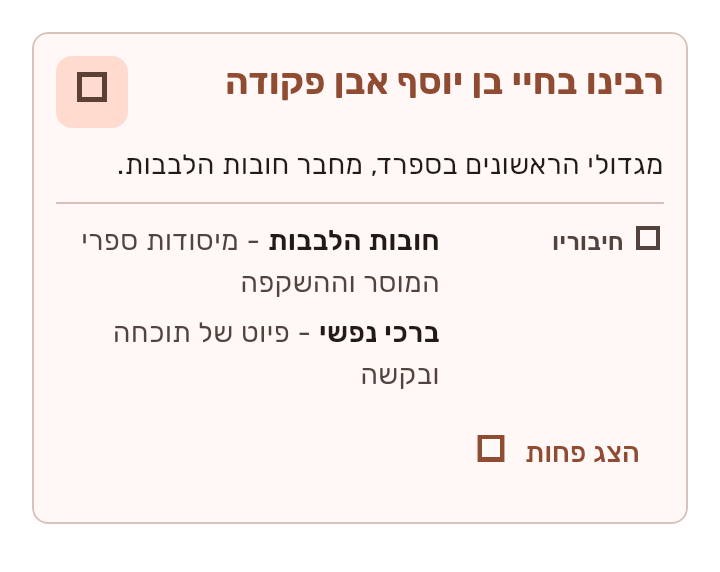
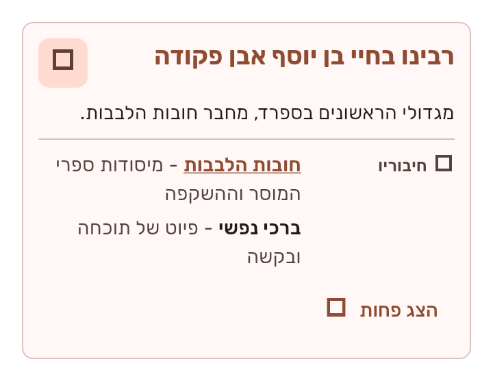
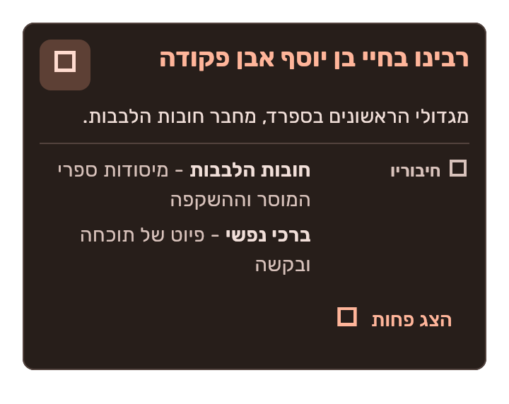
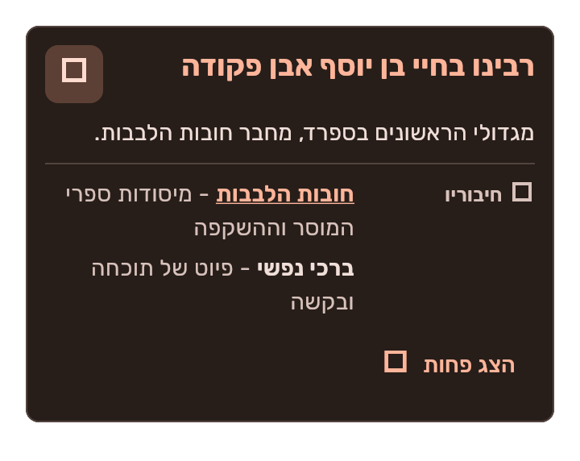

## מענה לסיבת הסגירה של #5660

#5660 נסגר כי ההתאמה לפי מחבר, תחילית כותרת ומדף עלולה לפתוח חיבור אחר. ה-PR הזה מוותר על ההתאמה הזו לגמרי: אין בו התאמה לפי מחבר, תחילית או מדף. חיבור מקושר רק כשיש לו מיפוי מאומת מהחיבור לספר בנתוני המקור.

1. **״פרי חדש״ פתח את ״פרי חדש על משנה תורה, הלכות יסודי התורה״.** בנתוני הביוגרפיות (v0.3.1) ״פרי חדש״ של רבי חזקיה די סילוה (Q5750050) מתואר כ״חיבור הלכה על השולחן ערוך״. בקטלוג יש רק כרכים של ״פרי חדש על משנה תורה״. אין אפוא ספר שמתאים לחיבור, ולכן הוא לא ממופה ומוצג כטקסט. בדיקה: `"פרי חדש" on the Shulchan Arukh does not open the commentary on Mishneh Torah by the same author`. היא נכשלה בראש הענף של #5660: `Expected: null, Actual: <Instance of 'TextBook'>`. כאן היא עוברת.
2. **״חובות הלבבות״ לא קושר כי שם המחבר בקטלוג חסר במיפוי.** הקישור כבר לא תלוי במיפוי המחברים. החיבור מקושר לפי `books: ["חובות הלבבות"]` במיפוי החיבורים, וזה עובד גם כש״בחיי אבן פקודה״ חסר ב-`author_biographies.json`. בדיקה: `"חובות הלבבות" opens its mapped book, whatever the catalog author is called`. היא נכשלה בראש #5660 (`Actual: <null>`) ועוברת כאן.
3. **״#5259 … אינו פותר זיהוי של חיבור או כרך. התאמה בטוחה דורשת מיפוי מאומת מחיבור לספר או לקבוצת כרכים בנתוני המקור.״** זה המימוש כאן. בבדיקת הנתונים לא נמצא מיפוי כזה: לחיבור בחבילת הביוגרפיות יש רק `title` ו-`description`, ולספרים בקטלוג אין מזהה חיבור. לכן הוספתי מיפוי מפורש בנתוני המקור, במאגר הביוגרפיות (PR נתונים נפרד, ראו למטה):
   - `config/work_books.json` ממפה מזהה ערך וכותרת חיבור לרשימת כותרות מדויקות של ספרים בקטלוג. רשימה של כמה כותרות היא קבוצת כרכים של אותו חיבור.
   - `app_bundle.py` מוסיף לחיבור בחבילת האפליקציה שדה `books`, שדה רשות. הגרסה של `biographies-app` נשארת 1: חבילה ישנה בלי השדה ממשיכה לעבוד, פשוט בלי קישורים.
   - `validate.py` נכשל כשהמיפוי מצביע על ערך או חיבור שאינם קיימים.
4. **בטיחות גם כשהספרייה משתנה.** האפליקציה פותחת ספר רק כשהכותרת הממופה שייכת לספר רשמי אחד בלבד בספרייה המותקנת. אם הכותרת משותפת לכמה ספרים, או שייכת רק לספר אישי, החיבור לא מקושר. בקבוצת כרכים נפתח הכרך הראשון ברשימה שקיים בספרייה.

## מה השינוי?

בכרטיס הביוגרפיה, בשורת ״חיבוריו״, חיבור שיש לו מיפוי לספר בספרייה מוצג כקישור שפותח את הספר: ‎`Semantics(link)`, InkWell עם מיקוד ו-Enter/Space, ו-tooltip ״פתח את הספר״. חיבור בלי מיפוי נשאר טקסט רגיל, כמו קודם.

- `BiographyWork.books`: הכותרות הממופות, מתוך `works[].books` בחבילה.
- `BiographiesRepository.libraryBooksByTitle()`: ספרי הספרייה הרשמית לפי כותרת. כותרת שמשותפת לכמה ספרים מושמטת.
- `BiographiesRepository.bookForWork(work, books)`: הכותרת הממופה הראשונה שנמצאה בספרייה. אין חיפוש לפי מחבר או לפי תחילית.
- המסך טוען את רשימת הספרים רק כשיש בחבילה חיבור ממופה, כך שבלי נתוני מיפוי לא מתווספת עבודה.

אין זה רגרסיה. זו השלמה של פיצ'ר, אחרי ש-#5660 נסגר (הניסיון הקודם, ענף `feat/biography-works-links-5203`). ממשק הקישור בכרטיס נלקח משם. ההתאמה הוחלפה.

## קישור לבעיה

Closes #5203

## תלות בנתונים

הקישורים יופיעו רק אחרי שה-PR של הנתונים ימוזג במאגר הביוגרפיות וייצא release חדש. הוא נמצא בענף `dudua99/toldot-gedolei-yisrael:feat/work-book-map-5203`, ובו 196 חיבורים של 152 ערכים. פירוט ההצלבה וכל רשומה עם אופן האימות שלה מופיעים בגוף ה-PR של הנתונים. עד אז האפליקציה מתנהגת בדיוק כמו היום.

החלטה למתחזקים: המיפוי נמצא במאגר הביוגרפיות, כי החיבורים מוגדרים שם. אפשר גם להעביר אותו ל-otzaria-library לצד `author_biographies.json`. צד האפליקציה לא תלוי במיקום, כל עוד השדה `books` מגיע בחבילה.

## הצהרות התורם

- [x] אני מאשר שה-PR שלי עומד ב[תנאי התרומה המפורטים ב-README](https://github.com/Otzaria/otzaria/blob/dev/README.md#תנאי-תרומה-חובה-לקריאה)
- [x] פיצ'ר חדש? — התייעצתי לפני כן (ב-issue, ובעקבות סגירת #5660)
- [x] שינוי UI? — צירפתי צילומי מסך לפני/אחרי בסוף התיאור
- [x] הרצתי `flutter analyze` על הקוד ואין שגיאות

## צילומי מסך (חובה בשינוי UI)

כרטיס פתוח ברוחב 360. ״חובות הלבבות״ ממופה, ״ברכי נפשי״ לא ממופה. הצילומים נלקחו בבדיקת widget זמנית עם גופן Rubik, ולכן האייקונים מוצגים כריבועים.

| לפני | אחרי |
|------|------|
|  |  |
|  |  |

## שינוי חזותי? (מערכת העיצוב)

1. **מטרה:** חיבור ממופה מוצג כקישור לספר.
2. **הכרעות (DD-xx):** אין הכרעה חדשה. סגנון הקישור הוא `linkStyle` הקיים בכרטיס, אותו סגנון של קישורי רבותיו, תלמידיו ומקורות.
3. **מה תוקן:** החיבור הוצג תמיד כטקסט, גם כשהספר קיים בספרייה.
4. **קבצי תשתית שהשתנו:** אין.
5. **רכיבים ומסכים מושפעים:** `BiographyCard` ו-`BiographiesScreen`.
6. **השפעה על התנהגות:** לחיצה על חיבור ממופה פותחת את הספר (`openBook`). כל השאר לא משתנה.
7. **צילומי לפני/אחרי:** בטבלה למעלה.
8. **בדיקות שהורצו:** ראו ״בדיקות״.
9. **בדיקות שלא הורצו:** בדיקה ידנית באפליקציה מול מסד גרסה 39 עם חבילה שכוללת `books`. מומלץ להריץ אחרי בניית חבילה מענף הנתונים.
10. **חריגים שנשארו:** אין. ב-`dart tool/ui_lint_cli.dart` אין הפרות חדשות.
11. **סיכוני רגרסיה:** נמוכים. בלי `books` בחבילה המסך לא טוען את הספרייה, והכרטיס זהה לקודם.
12. **PRs קשורים:** #5660 (נסגר) ו-#5259 (הכיוון ההפוך, מוזג). מבין ה-PRs הפתוחים, רק #5740 נוגע בקבצי הביוגרפיות (`biography_card.dart`, `biographies_screen.dart`), ו-`git merge-tree` מראה מיזוג נקי. מול שאר ה-PRs הפתוחים (58) אין קונפליקט חדש לעומת `dev`.

## בדיקות

- `test/tools/biography_work_books_test.dart`, בדיקה חדשה עם 6 מקרים: פענוח `books`, ״פרי חדש״ בלי קישור, ״חובות הלבבות״ מקושר, כותרת כפולה וספר אישי בלי קישור, קבוצת כרכים, וכרטיס שבו רק החיבור הממופה הוא קישור (`isLink`), כשלחיצה פותחת את הספר. על `dev` הבדיקה לא מתקמפלת, כי ה-API חסר. שני הכשלים המדווחים שוחזרו גם על ראש #5660, עם מיפוי המחברים האמיתי.
- בדיקות קשורות, כל מה שמייבא את הקבצים שהשתנו (18 קבצים, כולל `ui_lint_test`), הורצו ב-`flutter test -j 1`:
  - ענף: 773 עברו, 5 דולגו, 1 נכשל.
  - `dev`: 767 עברו, 5 דולגו, 1 נכשל.
  - הכשל זהה בשניהם: `plugin_bridge_adapter_test` ‏„כשל באמצע הכתיבה אינו פוגע בקובץ הקיים”. הוא תלוי בהרשאות קבצים, והסביבה רצה כ-root. אין קשר לשינוי.
- `flutter analyze` על הקבצים שהשתנו: נקי. `dart format --set-exit-if-changed`: נקי. `dart tool/ui_lint_cli.dart`: 0 הפרות חדשות.

<!-- SUITE -->
